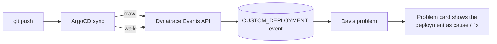

# ArgoCD + Dynatrace deployment enrichment

Reference pattern for correlating ArgoCD deployments with Davis problem detection in Dynatrace.

## What this solves

Davis correlates a problem to a probable cause using shared entities and a time window, but it has no
built-in notion that "a deployment just happened" unless something tells it so. This repo is that
notification: a `CUSTOM_DEPLOYMENT` event, sent at deploy time, targeted at the same entity Davis opens
problems on - so that when a problem does open, the deployment that likely caused it (and later, the
deployment that fixed it) shows up directly on the problem card.

## How it works



Full entity-model detail: [docs/architecture.md](docs/architecture.md).

## Start here: crawl → walk → run

This is a progression, not a menu - each tier builds on the last.

| Tier | What changes | Effort | What you get | Known limitation |
|---|---|---|---|---|
| **Crawl** | Add keys to your existing ArgoCD Notifications ConfigMap | ~15-30 min, zero pipeline changes | Deployment events on most problems | Entity targeting is non-deterministic in busy namespaces |
| **Walk** | Add one step to your existing deploy pipeline | ~15-30 min | Reliable correlation, every time | None found so far |
| **Run** | Optional, pick what's useful | Varies | Richer cards, broader coverage, automation | - |

## Crawl - ArgoCD-only, zero pipeline changes

If you already use ArgoCD Notifications for Slack, email, or anything else, you already have an
`argocd-notifications-cm` ConfigMap. **Merge these four keys into it - don't replace the file.** They're
new key names, so they won't touch or disable anything you already have.

**Prerequisites:** a Dynatrace tenant and an API token with `events.ingest` scope only.

```diff
 apiVersion: v1
 kind: ConfigMap
 metadata:
   name: argocd-notifications-cm
   namespace: argocd
 data:
   service.webhook.slack: |
     url: https://hooks.slack.com/services/...
+  service.webhook.dynatrace: |
+    url: https://<your-tenant>.live.dynatrace.com/api/v2/events/ingest
+    headers:
+      - name: Authorization
+        value: "Api-Token $dynatrace-api-token"
+      - name: Content-Type
+        value: application/json
+
+  template.dynatrace-deploy-event: |
+    webhook:
+      dynatrace:
+        method: POST
+        body: |
+          {
+            "eventType": "CUSTOM_DEPLOYMENT",
+            "title": "ArgoCD deploy {{.app.metadata.name}} @ {{.app.status.sync.revision}}",
+            "entitySelector": "type(CLOUD_APPLICATION),namespaceName({{.app.spec.destination.namespace}}),toRelationships.isClusterOfCa(type(KUBERNETES_CLUSTER),entityName(\"<your-cluster-name>\"))",
+            "properties": {
+              "dt.event.deployment.name": "{{.app.metadata.name}}",
+              "dt.event.deployment.version": "{{.app.status.sync.revision}}",
+              "source": "ArgoCD",
+              "cluster": "<your-cluster-name>"
+            }
+          }
+
+  trigger.on-dynatrace-deploy-succeeded: |
+    - when: app.status.operationState.phase in ['Succeeded']
+      send: [dynatrace-deploy-event]
+
+  trigger.on-dynatrace-deploy-failed: |
+    - when: app.status.operationState.phase in ['Error', 'Failed']
+      send: [dynatrace-deploy-event]
+
+  subscriptions: |
+    - recipients:
+        - dynatrace
+      triggers:
+        - on-dynatrace-deploy-succeeded
+        - on-dynatrace-deploy-failed
```

Plus the one-time secret (never commit the token itself):
```
kubectl patch secret argocd-notifications-secret -n argocd \
  -p '{"stringData":{"dynatrace-api-token":"<your Dynatrace API token>"}}'
```

Full file with inline comments: [crawl-argocd-notifications/argocd-notifications-cm.yaml](crawl-argocd-notifications/argocd-notifications-cm.yaml).

**How to confirm it worked:** after your next sync, check that the event landed and resolved to an
entity -
```
fetch events, from:now()-30m
| filter event.type == "CUSTOM_DEPLOYMENT"
| fields timestamp, event.name, affected_entity_ids
```

**Known limitation:** the entitySelector above targets `CLOUD_APPLICATION` via a cluster relationship. In
a namespace with several apps deploying around the same time, this doesn't always resolve to the right
entity - some syncs miss it. That's a confirmed finding, not a theoretical one. Walk fixes it.

## Walk - add one step for reliable correlation

Crawl's limitation comes from *which entity* the event targets. Walk targets the `SERVICE` entity
directly via a namespace relationship instead of `CLOUD_APPLICATION` via a cluster relationship - the same
event mechanism, a different (and reliable, in our testing) entitySelector.

This is the entire change: one step in your existing pipeline, plus the same `events.ingest`-scoped token
and your tenant ID as two more secrets. No new tooling, no change to how ArgoCD itself deploys anything.

```yaml
- name: Notify Dynatrace of deployment
  env:
    DT_TENANT: ${{ vars.DT_TENANT }}
    DT_API_TOKEN: ${{ secrets.DT_API_TOKEN }}
    APP: <your-app-name>
    NAMESPACE: <your-namespace>
    COMMIT_SHA: ${{ github.sha }}
    COMMIT_MESSAGE: ${{ github.event.head_commit.message }}
    GIT_URL: https://github.com/${{ github.repository }}/commit/${{ github.sha }}
  run: ./walk-cicd-events-api/emit-deployment-event.sh
```

(Written for GitHub Actions; the script itself is plain `curl` + `jq`, so it drops into GitLab CI,
Jenkins, CircleCI, or anything else unchanged - see
[walk-cicd-events-api/emit-deployment-event.sh](walk-cicd-events-api/emit-deployment-event.sh) for the
full env-var list and a non-GitHub example.)

**How to confirm it worked:** same query as crawl - `affected_entity_ids` should now be populated on
every deploy, not just most of them.

## Run - once crawl and walk are both working

Optional next steps, each a natural extension once the base pattern is proven - not a checklist you need
to clear.

1. **Richer event properties.** Add owner/team, stage, or project fields to `properties` - same event,
   more context in the root-cause narrative, and a basis for routing/ownership on the card.
2. **Full deploy lifecycle, not just one event.** Emit at deploy-start too, and a "fixed by deployment X"
   event once a remediation ships - the same cause/fix pairing this pattern already supports, applied
   across the whole deploy lifecycle instead of a single point in time.
3. **Scale to more than one service.** Template the entitySelector per ArgoCD Application (via
   ApplicationSets) or per CI job (via a build matrix) once it's proven on one service.
4. **Close the loop with automation.** A Dynatrace workflow keyed off problems whose root cause is a
   correlated deployment event - for example, routing a notification with the exact commit and owner, or
   triggering a rollback. This one is a genuinely larger effort than the first three, not another
   15-minute add - worth knowing going in.

## Try it risk-free first (optional)

Don't want to point either tier at a real service yet? [sandbox-app/](sandbox-app/) is a disposable
~30-line service with a `FAULT_INJECTION` toggle and a GitHub Actions workflow that flips it - enough to
reproduce the whole flow (deploy introduces a fault → problem opens → cause event appears → deploy fixes
it → fix event appears on the same card) without touching anything real. Useful at crawl, at walk, or not
at all - it doesn't gate either tier.

## Prerequisites

- A Dynatrace tenant (SaaS or Managed) and an API token scoped to `events.ingest` only - both tiers, no
  more scope than that.
- ArgoCD, with the Notifications Controller enabled (crawl) and/or an existing CI/CD pipeline that
  deploys your service (walk).

## Repo layout

```
crawl-argocd-notifications/   the ConfigMap keys to merge in
walk-cicd-events-api/          the standalone script to add as one pipeline step
sandbox-app/                   optional disposable service + k8s manifests for trying this risk-free
.github/workflows/             the workflow that drives the sandbox only
docs/                          architecture, full reference, troubleshooting
```

## Troubleshooting

See [docs/troubleshooting.md](docs/troubleshooting.md).

## Scope and support

This is a reference implementation for evaluation - illustrative and sanitized, meant to be adapted to
your environment rather than deployed as-is. It isn't an officially packaged or supported Dynatrace
deliverable.
