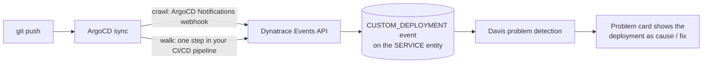

# Architecture

## Event flow



Both tiers end at the same place: a `CUSTOM_DEPLOYMENT` event in Dynatrace, targeted at the entity the
deployed service maps to. What differs is *how* the event gets sent, and *which entity* it targets -
that second difference is what determines whether Davis reliably attaches it to a problem.

## Why entity targeting matters

Davis correlates a problem to a probable cause using two things: a shared entity, and a time window. A
`CUSTOM_DEPLOYMENT` event is a point-in-time signal with a 15-minute default correlation window
(`dt.davis.timeout`) - if a problem opens on an entity within that window of the event, Davis treats the
deployment as a likely cause (or, for a later event, a likely fix) and shows it on the problem card.

That means the event's `entitySelector` has to resolve to the *same* entity the problem opens on:

- **Crawl** targets `CLOUD_APPLICATION` (the Kubernetes workload) via its cluster relationship. This
  entity exists and is useful, but in a namespace with several apps deploying around the same time, this
  selector doesn't always resolve to exactly the right one - some syncs miss it.
- **Walk** targets `SERVICE` directly via a namespace relationship. Dynatrace's own service detection
  already maps your deployed workload to a SERVICE entity; targeting that entity directly is what we
  found reliably correlates, because it's the same entity most Davis problems actually open on.

## The event body that makes this work

Both tiers emit the same event shape - a `CUSTOM_DEPLOYMENT` event with a markdown `event.description`:

```json
{
  "eventType": "CUSTOM_DEPLOYMENT",
  "title": "ArgoCD Sync: <app> (git#<short-sha>)",
  "entitySelector": "...",
  "properties": {
    "event.description": "Deployment from [<app>](<url>) by [ArgoCD](<url>) from [commit](<url>): \"<commit message>\""
  }
}
```

`properties.event.description` is rendered as markdown - including working `[text](url)` links - directly
under this event's title inside a problem's root-cause narrative. That's what puts a clickable "by ArgoCD
... from commit ..." line on the problem card, not just a bare timestamp.

See [reference.md](reference.md) for the full field list and both entitySelector patterns, and
[troubleshooting.md](troubleshooting.md) for the correlation window and markdown-rendering details.
